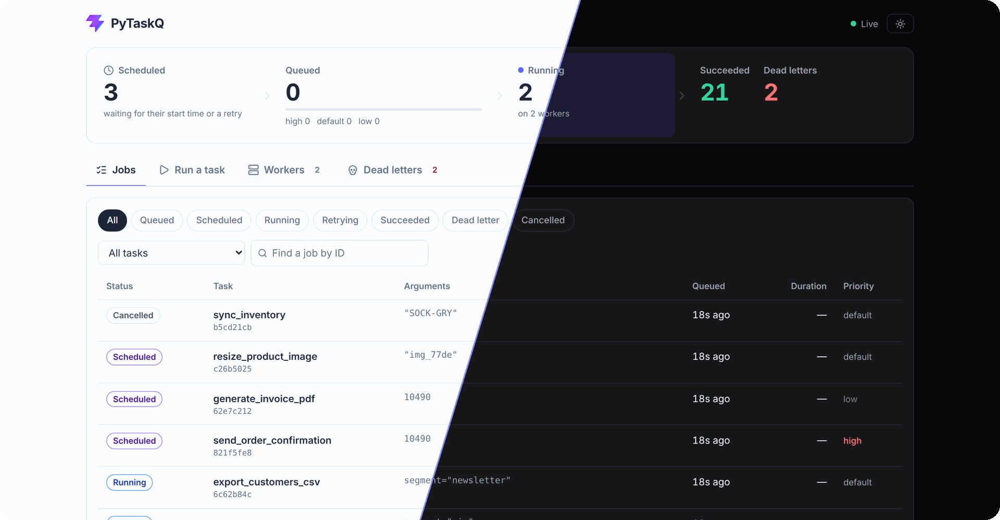
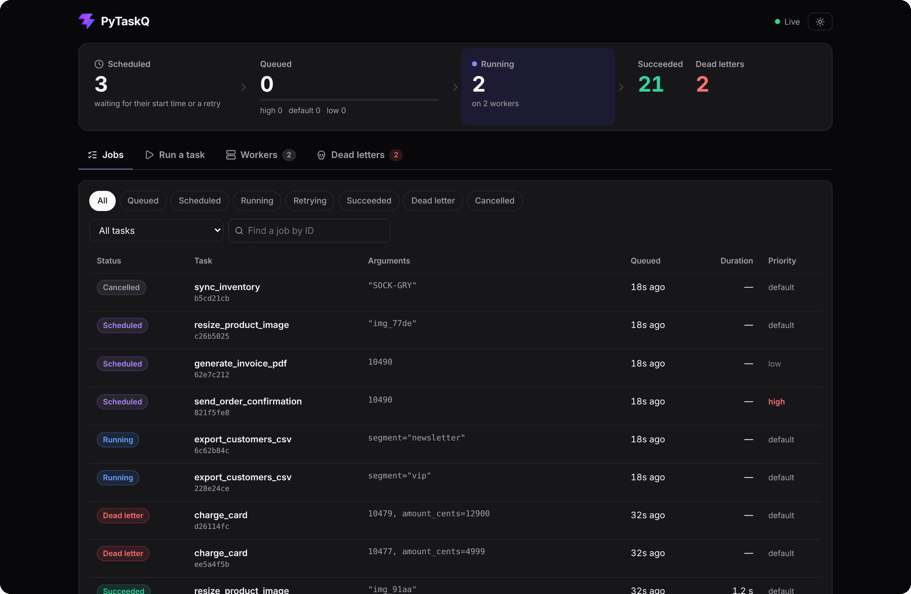
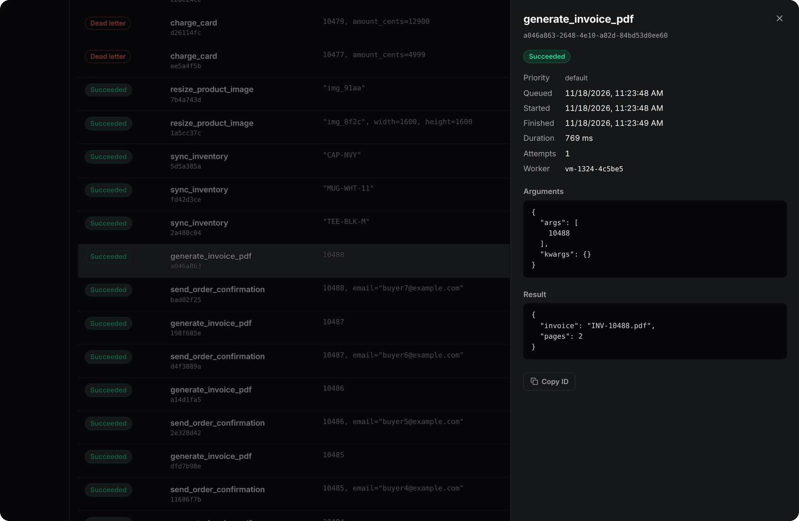
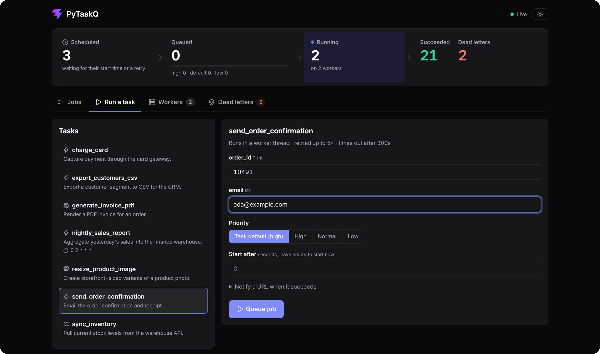
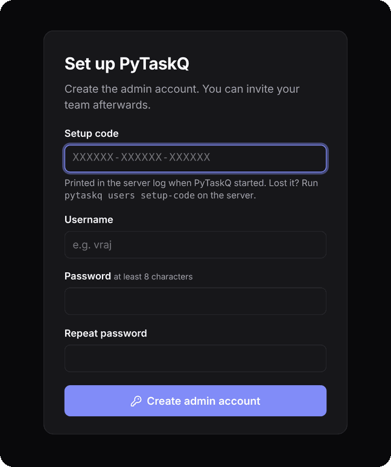

<div align="center">


# PyTaskQ

**Background jobs for Python — simple to start, safe in production.**

Decorate a function, call `.delay()`, and watch it run in a live dashboard.<br/>
Async-first, self-hosted, built on FastAPI and Redis.

[](https://pypi.org/project/pytaskq/)
[](https://pypi.org/project/pytaskq/)
[](https://github.com/vrajpatelm/PyTaskQ/actions/workflows/ci.yml)
[](https://github.com/vrajpatelm/PyTaskQ/blob/main/LICENSE)

[Quick start](#quick-start) · [Dashboard](#the-dashboard) · [Accounts](#accounts) · [Configuration](#configuration) · [How it works](#how-it-works) · [API](#rest-api) · [Self-hosting](#self-hosting)

<br/>



</div>

## Why PyTaskQ

- **Plain Python.** One decorator. Sync, `async def`, CPU-heavy and I/O-bound tasks each run in the right pool automatically.
- **See everything.** A live dashboard shows every job's arguments, timing, result and error, and lets you run, cancel and replay jobs.
- **Built for failure.** Retries with backoff, a dead-letter queue, crash recovery, fencing tokens and graceful shutdown come built in.
- **Self-hosted.** Accounts, roles, invite links, HTTPS and backups are included. Redis is the only thing you need to run.

## Quick start

You need Python 3.10+ and Redis (`docker run -p 6379:6379 redis:7` is enough).

```bash
pip install pytaskq
```

**1. Write tasks**

```python
# tasks.py
from pytaskq import PyTaskQ

queue = PyTaskQ()

@queue.task(type="io", priority="high", max_retries=5)
def send_order_confirmation(order_id: int, email: str):
    """Email the order confirmation and receipt."""
    ...

@queue.task                      # async def is detected automatically
async def sync_inventory(sku: str):
    ...

@queue.task(cron="0 2 * * *")    # every night at 02:00, once across all workers
def nightly_sales_report():
    ...
```

**2. Start a worker and the dashboard**

```bash
pytaskq worker    --app tasks:queue
pytaskq dashboard --app tasks:queue      # → http://localhost:8000
```

On first start, the dashboard prints a **setup code** in its log. Open the dashboard, enter the code and create your admin account.

**3. Queue jobs**

```python
await send_order_confirmation.delay(10481, email="ada@example.com")   # from async code
send_order_confirmation.delay_sync(10482, email="lin@example.com")    # from sync code

result = await queue.wait(task_id, timeout=30)   # {"status": "Success", "result": ..., "duration_ms": ...}
```

You can also queue jobs from the dashboard or over HTTP. Want to try it without writing code? Run `pytaskq worker --app pytaskq.task_registery:queue` and use the built-in demo tasks (`pip install "pytaskq[demo]"`).

## The dashboard

Live updates, light and dark themes, and a layout that works on phones.

**Jobs.** The lifecycle strip shows where every job is: scheduled, queued, running, succeeded or dead. Below it, filter recent jobs by status or task, or search by ID. Runs of the same job fold into one row, and the list holds still while you read it, with new jobs waiting behind a button.



**Job details.** Timings, the worker that ran it, attempts, arguments, and the result or error. Waiting jobs can be cancelled.



**Run a task.** Each task's form is built from its function signature: required fields, types, defaults, priority and delay.



**Dead letters.** Jobs that failed every retry, with their last error. Replay them once the cause is fixed.


**Workers.** Host, load, jobs done and failed, pool sizes, uptime and heartbeat health.

**Settings → Performance.** Whether the server is keeping up, what it turned away in the last 15 minutes, and which setting to change, ready to copy.


## Accounts

PyTaskQ has its own accounts, so you can expose it safely without an external service.

<table>
<tr>
<td width="60%" valign="middle">

**First start.** A one-time setup code is printed in the server log. Only someone with access to the server can create the first admin.

Lost it? Run `pytaskq users setup-code`. For automated installs, set `PYTASKQ_ADMIN_USER` and `PYTASKQ_ADMIN_PASSWORD` instead.

</td>
<td width="40%" align="center">

</td>
</tr>
</table>

**Your team.** Admins send single-use invite links (valid 7 days), change roles and disable accounts from *Settings → Team*.


| Role | Can |
|---|---|
| **Viewer** | See jobs, workers and dead letters |
| **Operator** | Also run, cancel, replay and delete jobs |
| **Admin** | Also invite people, change roles and disable accounts |

- **Scripts** use a personal API token from *Settings → API tokens*: `Authorization: Bearer ptq_…`. The token has its owner's role.
- **Locked out?** Run `pytaskq users reset-password NAME` on the server. `pytaskq users list | create | set-role | delete | setup-code` cover the rest.
- **Security.** Passwords are hashed with scrypt. Only SHA-256 hashes of sessions, invites and tokens are stored. Cookies are `HttpOnly` and `SameSite`, cross-site writes are blocked, and failed sign-ins are throttled. Serve the dashboard over HTTPS in production.
- **Local development:** `PYTASKQ_AUTH=off` turns sign-in off. Never use it on a server others can reach.

## Configuration

| Task option | Default | What it does |
|---|---|---|
| `type` | `"async"` for `async def`, else `"cpu"` | `"cpu"` process pool · `"io"` thread pool · `"async"` event loop |
| `priority` | `"default"` | `"high"`, `"default"` or `"low"` queue |
| `max_retries` | `3` | Retries with jittered backoff before dead-lettering |
| `timeout` | `300` s | Abandon and retry an attempt after this long |
| `cron` | — | 5-field cron schedule |
| `name` | function name | Registered task name |

App-wide defaults: `PyTaskQ(default_priority="low", max_retries=5, timeout=60)`.

Every server setting is an environment variable or a line in `.env`, and all of them are documented in [`.env.example`](https://github.com/vrajpatelm/PyTaskQ/blob/main/.env.example). The ones you'll most likely change are `REDIS_URL`, `MAX_RETRIES`, `TASK_TIMEOUT` and `QUEUE_CAPACITY`. For heavy traffic, [docs/PERFORMANCE.md](https://github.com/vrajpatelm/PyTaskQ/blob/main/docs/PERFORMANCE.md) explains which setting fixes what, with measurements from a 2-core server and a load test you can run on yours.

| Command | Purpose |
|---|---|
| `pytaskq worker --app m:queue [--cpu-workers N --io-workers N]` | Run a worker |
| `pytaskq dashboard [--app m:queue] [--port 8000] [--workers N]` | Dashboard and REST API |
| `pytaskq tasks --app m:queue` | List tasks and their settings |
| `pytaskq users …` | Manage accounts from the server |
| `pytaskq ping` | Check Redis and count workers |

## How it works


1. **Reliable pop.** A worker atomically moves a job into its own processing list, so a crash never loses it.
2. **Crash recovery.** Workers send a heartbeat every 10 s. An elected leader re-queues work from any worker that has been silent for 30 s.
3. **Fencing tokens.** A Lua script only accepts results carrying the current token, so a late result from a hung worker can't overwrite a newer one.
4. **Retries, then dead letters.** Failures back off with jitter. After `max_retries`, the job is dead-lettered with its last error.
5. **Graceful shutdown.** Ctrl+C finishes running jobs before exiting.
6. **Safe outbound calls.** Webhooks (`on_success_url=`) are signed with HMAC and retried. Use `pytaskq.net.assert_safe_url` to block requests to private networks.
7. **Safe retries.** Send an `Idempotency-Key` header (or `delay(..., idempotency_key=…)`) and a retried submission returns the original job instead of queueing a second one.
8. **Tracing (optional).** Set `OTEL_EXPORTER_OTLP_ENDPOINT` and one OpenTelemetry trace follows each job from the request that queued it through every attempt, in Jaeger, Grafana Tempo, Honeycomb or Datadog.

## REST API

Interactive docs are served at `/docs`, and the full reference is in [docs/API.md](https://github.com/vrajpatelm/PyTaskQ/blob/main/docs/API.md). Every route except `/health` and sign-in needs a session or API token.

| Method | Route | |
|---|---|---|
| `POST` | `/task/enqueue` | Queue a job (`task_name`, `args`, `kwargs`, `priority`, `delay_seconds`). Optional `Idempotency-Key` header |
| `GET` | `/task/{id}` | Status, timings, result or error |
| `POST` | `/task/{id}/cancel` | Cancel a waiting job |
| `GET` | `/tasks` | Recent jobs, filterable by status and task |
| `GET` | `/metrics`, `/system/workers`, `/dlq` | Queue, worker and dead-letter state |
| `POST` | `/dlq/replay/{id}`, `/dlq/retry_all` | Replay dead letters |

## Self-hosting

Run the official image `ghcr.io/vrajpatelm/pytaskq` (amd64 and arm64) on your own server. The production setup in [`deploy/`](https://github.com/vrajpatelm/PyTaskQ/tree/main/deploy) includes:

- **HTTPS** via Caddy, with an automatic Let's Encrypt certificate.
- **A private, password-protected Redis.** Only ports 80 and 443 are public.
- **Automatic backups** every 6 hours, plus a one-command restore.

```bash
cd deploy && cp .env.example .env     # set PYTASKQ_DOMAIN and REDIS_PASSWORD
docker compose -f docker-compose.prod.yml up -d
```

For your own tasks, build a worker image on top of the official one:

```dockerfile
FROM ghcr.io/vrajpatelm/pytaskq:0.3
COPY tasks.py .
CMD ["pytaskq", "worker", "--app", "tasks:queue"]
```

The full guide covers backups, restoring, upgrades and a security checklist: [docs/DEPLOYMENT.md](https://github.com/vrajpatelm/PyTaskQ/blob/main/docs/DEPLOYMENT.md). For local development, `docker compose up --build` in the repo root starts Redis, the dashboard, a worker and Jaeger.

## Development

```bash
pip install -e ".[dev,demo]"
python -m pytest             # in-memory via fakeredis, no Redis needed

cd frontend && npm install
npm run dev                  # dashboard with hot reload
npm run build                # writes the bundle into pytaskq/static/
```

See [CONTRIBUTING](https://github.com/vrajpatelm/PyTaskQ/blob/main/docs/CONTRIBUTING.md), [RELEASING](https://github.com/vrajpatelm/PyTaskQ/blob/main/docs/RELEASING.md) and the [CHANGELOG](https://github.com/vrajpatelm/PyTaskQ/blob/main/CHANGELOG.md).

## License

MIT
