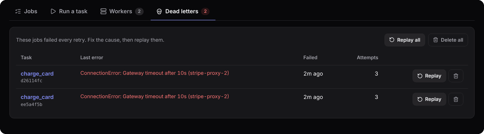
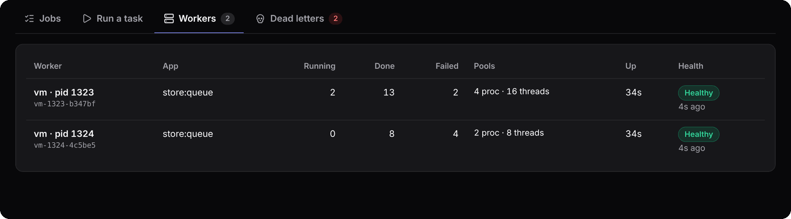
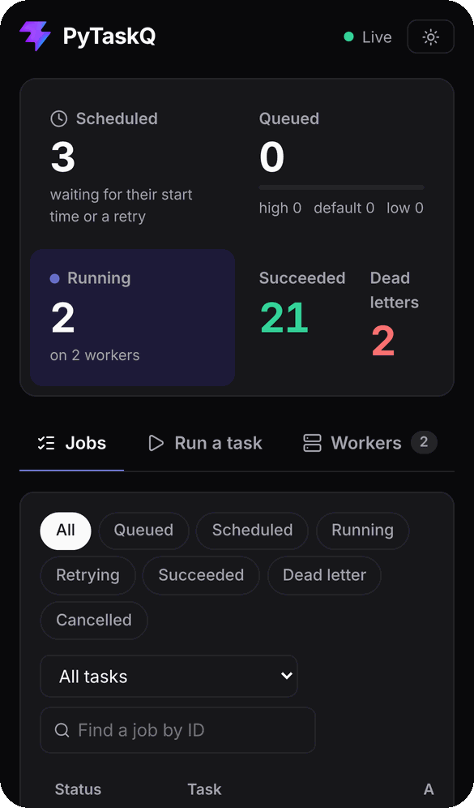
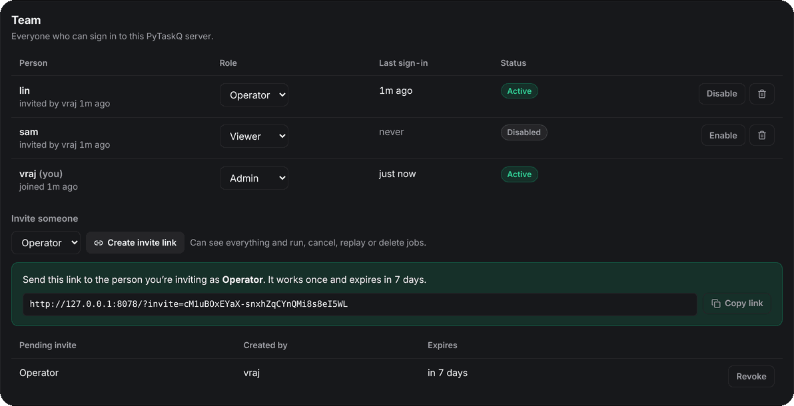
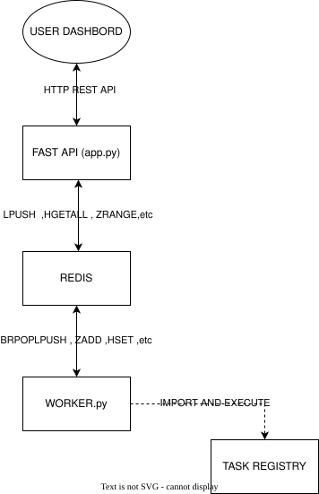

<div align="center">


# PyTaskQ

**Background jobs for Python — simple to start, safe in production.**

Decorate a function, call `.delay()`, and watch it run in a live dashboard.<br/>
Built natively on asyncio, FastAPI and Redis.

[](#quick-start)
[](https://github.com/vrajpatelm/PyTaskQ/actions/workflows/ci.yml)
[](#how-your-jobs-stay-safe)
[](LICENSE)

[Quick start](#quick-start) · [Dashboard](#the-dashboard) · [Accounts](#accounts-and-sign-in) · [Customising](#customising-tasks) · [Reliability](#how-your-jobs-stay-safe) · [API](#rest-api) · [What's new](#whats-new-in-02) · [What's next](#whats-next)

<br/>


</div>

---

## Why PyTaskQ

<table>
<tr>
<td width="50%" valign="top">

**Feels like plain Python**<br/>
One decorator. Sync, `async def`, CPU-heavy or I/O-bound tasks all work, and each is routed to the right pool automatically.

</td>
<td width="50%" valign="top">

**You can see everything**<br/>
A live dashboard shows every job's arguments, timing, result and error, and lets you run, cancel and replay jobs.

</td>
</tr>
<tr>
<td valign="top">

**Built for failure**<br/>
Fencing tokens, crash recovery, retries with jitter, a dead-letter queue and graceful shutdown are built in, not extra plugins.

</td>
<td valign="top">

**Two commands to run**<br/>
`pytaskq worker` and `pytaskq dashboard`. Redis is the only infrastructure.

</td>
</tr>
</table>

---

## Quick start

**You need** Python 3.10+ and Redis (`docker run -p 6379:6379 redis:7` is enough).

```bash
pip install -e .            # or: pip install -r requirements.txt
```

**1. Write tasks**

```python
# tasks.py
from pytaskq import PyTaskQ

queue = PyTaskQ()

@queue.task(type="io", priority="high", max_retries=5)
def send_order_confirmation(order_id: int, email: str):
    """Email the order confirmation and receipt."""
    ...

@queue.task(type="cpu", timeout=120)
def generate_invoice_pdf(order_id: int, currency: str = "USD"):
    """Render a PDF invoice for an order."""
    ...

@queue.task                                    # async def is detected automatically
async def sync_inventory(sku: str):
    ...

@queue.task(cron="0 2 * * *")                  # every night at 02:00, exactly once across the fleet
def nightly_sales_report():
    ...
```

**2. Start a worker and the dashboard**

```bash
pytaskq worker    --app tasks:queue
pytaskq dashboard --app tasks:queue            # → http://localhost:8000
```

The first time the dashboard starts, it prints a **one-time setup code** in its log. Open the dashboard, enter the code and create your admin account. See [Accounts and sign-in](#accounts-and-sign-in).

**3. Queue jobs from anywhere**

```python
await send_order_confirmation.delay(10481, email="ada@example.com")         # async code
await generate_invoice_pdf.apply_async(args=[10481], priority="low", countdown=30)
send_order_confirmation.delay_sync(10482, email="lin@example.com")          # plain sync code

result = await queue.wait(task_id, timeout=30)   # {"status": "Success", "result": ..., "duration_ms": ...}
await queue.cancel(task_id)                       # while it's still waiting
```

> **Just exploring?** `pytaskq worker --app pytaskq.task_registery:queue` runs built-in demo tasks you can trigger from the dashboard.

---

## The dashboard

Every view updates live over a WebSocket. Light and dark themes are both built in, and the layout works down to phone width.

### Know where every job is

The **lifecycle strip** follows a job from *Scheduled* through *Queued* and *Running* to *Succeeded* or *Dead letters*. It also shows how full your queue is and how jobs split across priorities. Below it, **Jobs** lists recent work with filters for status and task, plus search by ID.


### Inspect any job

Click a row to open its full record: when it was queued, started and finished, how long it took, which worker ran it, how many attempts it needed, its arguments, and its result or error. Waiting jobs show a **Cancel job** button.


### Run a task without writing code

Workers announce their tasks, docstrings and parameters. **Run a task** turns each function signature into a form, showing which fields are required, their types and their defaults. Choose a priority, add a delay, or set a webhook, then queue the job.


### Fix failures, then replay

**Dead letters** collects jobs that failed every retry, along with their last error. Replay one or all of them, and each goes back to its original priority queue.



### Watch your workers

**Workers** shows the host, process, app, live load, completed and failed counts, pool sizes, uptime and heartbeat health for every worker.



<table>
<tr>
<td width="62%" valign="middle">

### Works on your phone

The same dashboard adapts to small screens, so you can check on a deploy or replay a failed job from anywhere.

When no worker is running, the dashboard tells you so, with the exact command to start one.

</td>
<td width="38%" align="center">

</td>
</tr>
</table>

---

## Accounts and sign-in

PyTaskQ is built to be self-hosted, so it ships with its own accounts. There's no external service to set up.

<table>
<tr>
<td width="50%" valign="top">

**First start.** The server log prints a one-time setup code. Only someone who can see the server's logs can create the first admin, so a stranger can't claim a freshly exposed server.


</td>
<td width="50%" valign="top">

**Your team.** Admins create single-use invite links (valid for 7 days). Teammates choose their own username and password. Roles can be changed and accounts disabled at any time.



</td>
</tr>
</table>

| Role | Can |
|---|---|
| **Viewer** | See jobs, workers and dead letters |
| **Operator** | Everything a viewer can, plus run, cancel, replay and delete jobs |
| **Admin** | Everything, plus invite people, change roles and disable accounts |

**Scripts and services** use a personal API token from *Settings → API tokens*. It acts as you, with your role:

```bash
curl -X POST https://pytaskq.example.com/task/enqueue \
     -H "Authorization: Bearer ptq_…" -H "Content-Type: application/json" \
     -d '{"task_name": "send_order_confirmation", "kwargs": {"order_id": 10481, "email": "ada@example.com"}}'
```

**Locked out?** Every account command works on the server, straight against Redis:

```bash
pytaskq users list
pytaskq users reset-password vraj
pytaskq users create ops --role admin
pytaskq users setup-code              # if you missed it in the log
```

**How it's protected.** Passwords are hashed with scrypt. Sessions, invites and tokens are random 256-bit secrets, and Redis stores only their SHA-256. The session cookie is `HttpOnly` and `SameSite=Lax`, writes from other websites are rejected, and repeated failed sign-ins are throttled. Behind HTTPS, the cookie is automatically marked `Secure`.

> For local development you can turn sign-in off with `PYTASKQ_AUTH=off`. Never do this on a server others can reach.

---

## Customising tasks

| Option | Default | What it does |
|---|---|---|
| `type` | `"async"` for `async def`, otherwise `"cpu"` | `"cpu"` → process pool · `"io"` → thread pool · `"async"` → worker event loop |
| `priority` | `"default"` | Default queue: `"high"`, `"default"` or `"low"` (callers can override) |
| `max_retries` | `MAX_RETRIES` (3) | Retries with decorrelated-jitter backoff before a job is dead-lettered |
| `timeout` | `TASK_TIMEOUT` (300 s) | Abandon and retry an attempt after this long (`0` = never) |
| `cron` | — | 5-field cron expression, enqueued once per tick by the elected leader |
| `name` | function name | The name the task is registered under |

Bad options fail when your module is imported, not at 2 a.m. in production.

**App-wide defaults:** `PyTaskQ(default_priority="low", max_retries=5, timeout=60)`

**Worker sizing:** `pytaskq worker --app tasks:queue --cpu-workers 4 --io-workers 32 --timeout 120`

**Configuration:** every setting is an environment variable or a line in `.env`. See [`.env.example`](.env.example). Redis is set with `REDIS_URL`, or with `REDIS_HOST`, `REDIS_PORT`, `REDIS_DB` and `REDIS_PASSWORD`.

| Command | Purpose |
|---|---|
| `pytaskq worker --app m:queue` | Run a worker |
| `pytaskq dashboard [--app m:queue]` | Dashboard + REST API on port 8000 |
| `pytaskq tasks --app m:queue` | List tasks, parameters, retries and schedules |
| `pytaskq ping` | Check Redis and count live workers |

---

## How your jobs stay safe



1. **Reliable pop.** A worker atomically moves a job from `queue:{priority}` into its own `processing_queue:{worker_id}`. If the machine dies, the job is still in Redis.
2. **Zombie sweeper.** Workers heartbeat every 10 s. An elected leader re-queues work from any worker that has gone silent for 30 s.
3. **Fencing tokens.** Every recovery or timeout bumps the job's token, and a Lua script only accepts a result carrying the current one. A late result from a hung worker can't overwrite a newer one.
4. **Retries, then dead letters.** Failures back off with decorrelated jitter. After `max_retries`, the job lands in the DLQ with its last error, ready to replay.
5. **Graceful shutdown.** Ctrl+C or SIGTERM stops new pulls, finishes running jobs and deregisters the worker.
6. **SSRF guard.** Webhooks and URL-fetching tasks refuse private, loopback and cloud-metadata addresses. Use `pytaskq.net.assert_safe_url` in your own tasks.

**Webhooks.** Pass `on_success_url=` and the worker queues a signed POST (`X-PyTaskQ-Signature`, HMAC-SHA256 with `WEBHOOK_SECRET`). The webhook is retried like any other job.

**Tracing** is opt-in. Set `OTEL_EXPORTER_OTLP_ENDPOINT` to get one continuous trace from the API, through Redis, into the worker. Docker Compose sets this up for the bundled Jaeger.

---

## REST API

Interactive docs are served at `/docs`. Full examples are in [docs/API.md](docs/API.md). Every route except `/health` and the sign-in routes needs a session or an `Authorization: Bearer ptq_…` token. Reading needs *viewer*; changing jobs needs *operator*.

| Method | Route | Description |
|--------|-------|-------------|
| `POST` | `/task/enqueue` | Queue a job: `task_name`, `args`, `kwargs`, `priority`, `delay_seconds`, `on_success_url` |
| `GET` | `/task/{task_id}` | Status, timings, result or error |
| `POST` | `/task/{task_id}/cancel` | Cancel a job that hasn't started |
| `GET` | `/tasks` | Recent jobs, filterable by `status`, `task_name`, `limit` |
| `GET` | `/tasks/registered` | Tasks advertised by workers, with parameters |
| `GET` | `/metrics` | Queue depths, counters, worker count |
| `GET` | `/system/workers` | Worker fleet details |
| `GET` | `/dlq` | Dead letters with their last error |
| `POST` | `/dlq/replay/{id}`, `/dlq/retry_all` | Put dead letters back on their original queue |
| `POST` | `/dlq/purge/{id}`, `/dlq/purge_all` | Delete dead letters |

Account routes live under `/auth`: `status`, `setup`, `login`, `logout`, `me`, `me/password`, `me/tokens`, `users`, and `invites`.

---

## Docker

```bash
docker compose up --build        # Redis + dashboard/API + worker + Jaeger
```

The worker runs `example_app:queue`. Point `command:` and `PYTASKQ_APP` in `docker-compose.yml` at your own module.

Get the first-run setup code with `docker compose logs web | grep -A4 "setup code"`, or `docker compose exec web pytaskq users setup-code`. Accounts live in Redis, so they survive rebuilds through the `redis-data` volume.

## Development

```bash
pip install -r requirements.txt
python -m pytest                 # 155 tests, in-memory via fakeredis — no Redis needed

cd frontend && npm install
npm run dev                      # dashboard with hot reload, talking to localhost:8000
npm run build                    # writes the bundle into pytaskq/static/
```

---

## What's new in 0.3

- **Accounts for self-hosting.** First-run setup with a one-time code, sign-in, Viewer / Operator / Admin roles, invite links, personal API tokens, and a Settings tab for your account and your team. `pytaskq users …` commands handle recovery.
- **Continuous integration.** Every push runs the test suite on Python 3.10, 3.12 and 3.13, a bug-finding lint pass, and a dashboard build that checks the committed bundle is current.
- **Ready for PyPI.** `pyproject.toml` packaging includes the dashboard, and tagging a release publishes it automatically.
- **Fix:** the demo `resize_image` task had lost an import and failed on every call. The new lint step caught it.

## What's new in 0.2

This release focused on three things: making PyTaskQ easy to adopt, making the dashboard useful day to day, and fixing bugs that silently lost work.

<details open>
<summary><b>Fixes to how jobs behave</b></summary>

- **Timed-out jobs.** When a timed-out job was retried and then succeeded, its result was silently discarded because the retry carried a stale fencing token. Retries now carry the new token.
- **Retry priority.** Retries used to fall back to the default queue. They now keep their priority, and so do jobs replayed from the dead-letter queue.
- **Webhooks.** They only worked for the built-in demo app. Every app now includes the webhook task.
- **"Not found" while waiting.** Looking up a queued job returned "not found". Jobs now have a status the moment they're queued.
- **Docker dashboard.** The demo dropdown listed tasks the Docker worker didn't have, so 3 of 4 always failed. The dashboard now shows the tasks your workers actually register.
- **Counters.** Webhook follow-ups no longer push the pending counter negative.

</details>

<details open>
<summary><b>Easier to use</b></summary>

- **CLI:** new `pytaskq dashboard`, `pytaskq tasks` and `pytaskq ping` commands, and `--cpu-workers`, `--io-workers` and `--timeout` flags for workers.
- **Task options:** `async def` tasks, keyword arguments, `delay_sync()` for sync code, and `apply_async(countdown=, priority=, task_id=)`.
- **Per-task settings:** `max_retries`, `timeout`, `priority` and `name`, plus app-wide defaults, all validated at import.
- **Results:** `queue.status()`, `queue.wait()` and `queue.cancel()`. Results are stored as JSON.
- **Clearer errors:** an unknown task name returns a 404 that lists the real task names.
- **Lighter import:** `from pytaskq import PyTaskQ` no longer pulls in numpy and Pillow.
- **Quieter logs:** tracing is opt-in, so there's no error spam when Jaeger isn't running.
- **Packaging:** `pip install .` now installs everything needed to run. The dashboard runs from any directory, and Vite builds straight into the package.

</details>

<details open>
<summary><b>The dashboard, rebuilt</b></summary>

- A lifecycle strip, plus tabs for Jobs, Run a task, Workers and Dead letters.
- Job history with filters, search by ID and a detail panel with a cancel button.
- Forms generated from your task signatures.
- Dead letters show their last error, and "Delete all" asks for confirmation first.
- Worker health, load and throughput.
- A connection indicator, and a hint when no worker is running.

</details>

<details open>
<summary><b>Tests</b></summary>

- 66 new tests covering the SDK, worker behaviour, every REST endpoint, the DLQ fixes and the CLI. The suite now has **120 tests**.
- Tests that relied on DNS are now hermetic, so the suite passes offline.
- The release was also verified end to end: real Redis, two workers, the API and a headless browser.

</details>

---

## What's next

These are suggested next steps, roughly in order of impact.

1. **Single sign-on.** Sign in with GitHub, Google or your company's OIDC provider, alongside local accounts.
2. **Audit log.** A Settings page showing who queued, cancelled, replayed or deleted what, and when. Jobs already record `created_by` and `cancelled_by`.
3. **One-command install.** A published Docker image (`ghcr.io/vrajpatelm/pytaskq`) and a `docker-compose.prod.yml` with HTTPS via Caddy.
4. **Workflows.** Chains (`a.then(b)`), groups and callbacks, so a job's result can feed the next job without glue code.
5. **Progress reporting.** Let a task report `progress(0.4, "rendering page 2")` and show it as a live bar in the job panel.
6. **Queue controls.** Pause and resume a queue, per-task rate limits, and unique jobs that skip duplicates while one is pending.
7. **Metrics export.** A Prometheus `/metrics/prometheus` endpoint (throughput, latency percentiles, failure rate) for existing Grafana setups.
8. **High availability.** Redis Sentinel or Cluster support, to remove the single point of failure.
9. **Self-hosted font.** Bundle Inter with the dashboard so it looks the same on offline or locked-down networks.
10. **Documentation site.** A short guide (MkDocs) with recipes for FastAPI, Django and Flask, deployment and scaling.

See [docs/ROADMAP.md](docs/ROADMAP.md) for the full, living roadmap.

---

<div align="center">
<sub>MIT licensed · Built with asyncio, FastAPI, Redis and React</sub>
</div>
