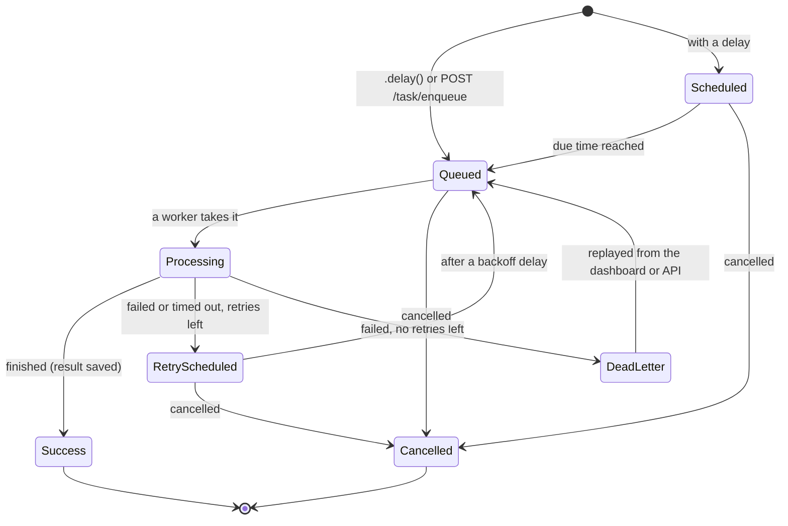

# How PyTaskQ works

PyTaskQ runs Python functions in the background. Your app queues a job, a worker runs it, and the dashboard shows what happened. This page explains the moving parts, where each one lives in the code, and how they keep jobs safe when things go wrong.

## The pieces

```
 your app ──.delay()──────────┐
                              ▼
 browser / scripts ──HTTP──▶ API + dashboard ──▶ Redis ◀── worker(s)
                             (pytaskq dashboard)          (pytaskq worker)
```

- **Your app** queues jobs with the SDK (`task.delay()`), which writes straight to Redis. No HTTP hop.
- **Workers** (`pytaskq worker --app tasks:queue`) take jobs from Redis and run them. Run as many as you like, on any machine that reaches Redis.
- **The API and dashboard** (`pytaskq dashboard`) is a FastAPI server with a React dashboard. People and scripts use it to queue, watch, cancel and replay jobs. It's optional for your app, which can queue jobs without it.
- **Redis** holds everything: queues, job records, accounts and statistics. It is the only service PyTaskQ needs.

## Where things live in the code

| Path | What it does |
|---|---|
| `pytaskq/app.py` | The SDK: `PyTaskQ()`, `@queue.task`, `.delay()`, `.schedule()`, `.apply_async()`, `.delay_sync()`, `queue.wait()` |
| `pytaskq/core/queueing.py` | Everything that writes a job to Redis: named queues, enqueue (with idempotency keys), cancel, job history, the task registry, counting jobs |
| `pytaskq/worker.py` | The worker: choosing its queues, taking jobs, retries, dead letters, crash recovery, the heartbeat thread, cron (with time zones), shutdown |
| `pytaskq/pools.py` | Where task code runs: one process per CPU job (stopped at its timeout, replaced if it dies) and IO threads |
| `pytaskq/core/clock.py` | Redis's clock, used for every time another machine compares against |
| `pytaskq/main.py`, `pytaskq/api/v1/` | The API: jobs, dead letters, workers, metrics, sign-in, the live WebSocket |
| `pytaskq/core/auth.py`, `core/dependencies.py` | Accounts, sessions, API tokens, invites, roles |
| `pytaskq/core/redis_client.py` | The shared Redis connection pool |
| `pytaskq/core/pressure.py`, `services/performance.py` | Counting refused requests, and the advice in *Settings → Performance* |
| `pytaskq/services/live.py` | Live dashboard updates |
| `pytaskq/tracing.py` | Optional OpenTelemetry tracing |
| `pytaskq/net.py` | Webhook URL safety checks |
| `frontend/` | The dashboard (React + Vite), built into `pytaskq/static/` |

## What's in Redis

| Key | Type | Holds |
|---|---|---|
| `queue:high`, `queue:default`, `queue:low` | List | Jobs waiting on the `default` queue, one list per priority |
| `queue:{name}:{priority}` | List | Jobs waiting on another named queue (e.g. `queue:images:high`) |
| `pytaskq:queues` | Set | Every queue name that has been used |
| `processing_queue:{worker}` | List | Jobs a worker is running right now (its safety net if it crashes) |
| `delayed_tasks` | Sorted set | Scheduled jobs and retries, scored by the time they're due |
| `dlq` | List | Dead letters: jobs that failed every retry, with their last error, and "(invalid job)" entries (the newest `DLQ_LIMIT`) |
| `task:{id}` | Hash | One job's record: status, the job itself (`payload`, which holds its arguments), timings, result or error. Kept while the job waits or runs; expires `RESULT_TTL` (a day) after it finishes |
| `tasks:recent` | List | The newest `HISTORY_LIMIT` job ids, for the Jobs list |
| `fence:{id}` | String | The job's fence token (see *Fencing* below) |
| `active_workers`, `worker:{id}` | Sorted set, Hash | Which workers are alive (heartbeat, on Redis's clock), and each one's counters and health |
| `pytaskq:workers` | Set | Every worker that may own a `processing_queue`, so the leader also finds the lists of workers that stopped without a heartbeat |
| `pytaskq:leader_lock`, `cron_lock:{task}:{tick}` | String | Which worker runs the background loops; one run per cron tick |
| `pytaskq:registry`, `pytaskq:registry:seen` | Hash, Sorted set | Tasks that running workers advertise, and when each was last advertised |
| `idempotency:{key}` | String | Which job an `Idempotency-Key` created. Expires after `IDEMPOTENCY_TTL` (a day) |
| `stats:completed`, `stats:failed` | String | All-time totals. Everything else the dashboard counts is read from the lists above |
| `stats:pressure:{minute}` | Hash | Requests turned away, and jobs handed back, per minute |
| `auth:*` | various | Users, sessions, API tokens and invites (secrets stored only as SHA-256 hashes) |
| `events:global` | Pub/sub channel | "Something changed": wakes up open dashboards |

## The life of a job



1. **Queueing.** One Lua script checks the idempotency key and (for the API) the queue's capacity, then pushes the job onto its queue's priority list (or into `delayed_tasks`), creates its `task:{id}` record, adds it to the history and announces the change. Because it's one step, `QUEUE_CAPACITY` is exact even under hundreds of parallel requests. Before that, the API checks in one round trip that the task exists and accepts the arguments given. Jobs over `MAX_PAYLOAD_BYTES` are refused.
2. **Taking a job.** A worker only takes jobs from the queues it serves (by default, the queues its own tasks live on). A Lua script pops from every served queue's `high` list, then `default`, then `low`, taking turns between queues at the same priority, and moves the job into the worker's own `processing_queue` in the same step. A job is never only in the worker's memory.
3. **Running it.** Each task runs where it belongs: `async def` tasks on the worker's event loop, `type="io"` tasks in threads, and `type="cpu"` tasks in separate processes (separate cores, no GIL), one job per process. A worker holds up to *CPU processes + IO threads* jobs at once (`WORKER_CPU_WORKERS`, `WORKER_IO_WORKERS`). A job waits for a free process or thread, and only then is it marked *Processing* and its `timeout` starts. At the timeout a CPU job's process is stopped and replaced, an async task is cancelled, and an IO thread (which Python can't stop) keeps its slot until its code returns. [WORKERS.md](WORKERS.md) has the details.
4. **Success.** One Lua script checks the fence token, saves the result (results over `MAX_RESULT_BYTES` are replaced by a note), starts the record's `RESULT_TTL`, and removes the job from the processing list. If Redis can't be reached at that moment, the worker keeps the result and retries until it can. If the job had an `on_success_url`, a signed webhook delivery is queued as a follow-up job.
5. **Failure.** The worker schedules a retry after a random backoff of 1 to 30 seconds (decorrelated jitter, so many failing jobs don't all retry at the same moment). After `max_retries` the job becomes a dead letter, with its last error. Recording this and removing the job from the processing list are again one script.

## Running more than one worker

- **Heartbeats.** Every worker refreshes its entry in `active_workers` every 10 seconds, from a thread of its own with its own Redis connection, so a task that blocks the event loop doesn't make a healthy worker look dead. An entry older than `WORKER_HEARTBEAT_TTL` (30 s) means the worker is gone. The same thread warns when the event loop is blocked and names the task.
- **One clock.** Heartbeats, retry times and schedules use Redis's clock (`TIME`), so machines whose clocks disagree still agree on who is alive and what is due.
- **One leader.** The background loops run on a single worker at a time, elected with a Redis lock that expires if the leader dies (taken and renewed by one Lua script, so a leader can't renew someone else's lock). The loops are: moving due scheduled jobs and retries onto their queues (in batches of 500, and only while a queue is below `QUEUE_CAPACITY`), starting cron jobs, and recovering jobs from workers that are gone.
- **Recovering jobs.** A job of a gone worker goes back to the front of its own queue, at its own priority, in one Lua script that does nothing if the job has just finished or failed. Workers that stopped without a heartbeat but still list jobs are found too. A worker with a fixed `WORKER_NAME` puts back its own unfinished jobs the moment it restarts.
- **Named queues.** Each task lives on a queue and each worker serves a set of queues, so a kind of work can have its own workers ([QUEUES.md](QUEUES.md)). Every path a job takes keeps its queue: retries, crash recovery, dead-letter replays, cancellation, webhook follow-ups and cron.
- **Cron.** Schedules are read in the task's `tz` (default `CRON_TIMEZONE`, UTC), not the machine's clock. Each run is claimed with a `SET NX` lock keyed by the local clock time, so a scheduled task runs once per tick across the whole fleet, and once when clocks go back. The lock, the job's record and the push are one script, so a fast worker can't finish the job before its record exists.
- **A worker without the task.** If two apps share a queue, a worker can take a job whose task it doesn't have. It hands the job back (through the delayed set) for a worker that has it, for up to 10 minutes, without counting a retry.
- **Task registry.** Each worker advertises its tasks every minute, so the dashboard can build its *Run a task* forms and the API can reject unknown task names. Workers running different apps are all listed, and a task drops out about 5 minutes after nothing advertises it.

## Fencing: why a job's result can't be overwritten by a stale attempt

Sometimes two attempts at the same job exist at once: a worker hangs and its job is recovered elsewhere, or an attempt times out but the code keeps running in its thread. Each job has a **fence token**. Whenever a job is taken away from an attempt (recovered from a dead worker, or timed out), the token goes up, and the new attempt carries the new token.

- Saving a result only works with the current token (checked inside a Lua script), so a late result from an old attempt is dropped.
- Recording a failure checks the token too, atomically (`WATCH`). An old attempt that fails can't schedule a second copy of the job or dead-letter it.
- A timeout only raises the token if the attempt still owns the job.

## The API

- **Sign-in on every request** is one Redis call (a Lua script resolves the session or token to its user). Nothing is cached, so revoking a token, disabling a user or changing a role takes effect on the next request.
- **Roles.** Viewers can read everything, operators can also run, cancel and replay jobs, and admins can also manage people. Cookie-authenticated writes from other websites are refused, and cookies are never accepted cross-origin unless the origin is listed in `ALLOWED_ORIGINS`.
- **Redis connections** come from a pool (`REDIS_MAX_CONNECTIONS`, default 200 per process). When they're all busy, a request waits up to `REDIS_POOL_TIMEOUT` seconds for one instead of failing.
- **Saying no politely.** When the queues hold `QUEUE_CAPACITY` jobs, new ones get `429`. When Redis can't be reached in time, requests get `503`. Both carry `Retry-After`, are logged with the reason, and are counted for *Settings → Performance*.
- **Idempotency keys.** A job sent with an `Idempotency-Key` is queued once. The key check and the enqueue happen in one atomic step, so even simultaneous retries create one job.
- **Live updates.** Each API process keeps one Redis subscription to `events:global`, and each open dashboard is refreshed at most `LIVE_UPDATES_PER_SECOND` times a second, however fast jobs change.
- **More cores.** `pytaskq dashboard --workers N` runs several API processes.

## Tracing (optional)

With `OTEL_EXPORTER_OTLP_ENDPOINT` set, one OpenTelemetry trace follows each job. A queued job is JSON in Redis, with no HTTP headers to carry a trace, so the trace context travels inside the job as `trace_carrier`:

```
POST /task/enqueue        (API, continues the caller's traceparent)
  └─ enqueue send_email   (writes trace_carrier into the job)
       └─ run send_email  (worker, one span per attempt)
            └─ enqueue _deliver_webhook → run _deliver_webhook
```

Spans record task names, job ids, attempts, workers, route patterns and status codes, never URLs, headers, bodies or job arguments.

## What happens when things go wrong

| What goes wrong | What PyTaskQ does |
|---|---|
| A worker crashes or loses power | The job is still in its `processing_queue`. When its heartbeat stops, the leader puts the job back at the front of its queue and raises its fence token. With a `WORKER_NAME`, the restarted worker does this itself at once. |
| A CPU task's process dies (out of memory, a C extension crash) | That job fails with `ProcessCrashed` and is retried; a new process takes the slot. Other jobs carry on. |
| A job hangs | The attempt is abandoned at its `timeout` (a CPU job's process is stopped), the token goes up, and a retry is scheduled. If hung IO code ever finishes, its result is dropped. If every IO thread is stuck, the worker leaves IO jobs for other workers. |
| An `async def` task blocks the event loop | The heartbeat (its own thread) keeps the worker alive, so the job isn't started a second time elsewhere. The log, the Workers tab and *Settings → Performance* name the task. |
| A "dead" worker comes back while its job runs elsewhere | Its stale result and its stale failure are both ignored (fencing). The job runs to completion once. |
| A job keeps failing | Retries with jittered backoff, then a dead letter with the last error. Replay it from the dashboard once the cause is fixed. Two people replaying it at once still queue it once. |
| Redis is down when a job finishes | The worker keeps the outcome in memory and saves it once Redis is back. |
| Something that isn't a valid job reaches a queue | It becomes an "(invalid job)" dead letter with the text that was sent, instead of vanishing. |
| Jobs arrive faster than workers finish them | Each queue absorbs bursts up to `QUEUE_CAPACITY`, then new API jobs for it get `429` with `Retry-After`. Other queues aren't affected. *Settings → Performance* suggests what to change. |
| Jobs wait in a queue no worker serves | The dashboard marks the queue, and *Settings → Performance* says which worker to start. Their records don't expire while they wait. |
| A task returns a huge result, or is sent huge arguments | Results over `MAX_RESULT_BYTES` aren't stored (the job still succeeds); jobs over `MAX_PAYLOAD_BYTES` are refused. |
| A client isn't sure its job was queued | It resends with the same `Idempotency-Key` and gets the original job back. |
| Redis is busy or briefly down | API requests wait for a connection, then answer `503` with `Retry-After`. Workers pause and retry until Redis is back. |
| Ctrl+C or `docker stop` | The worker stops taking jobs and gives running ones `WORKER_SHUTDOWN_GRACE` (30 s) to finish. Whatever is still running is stopped and put back at the front of its queue. |
